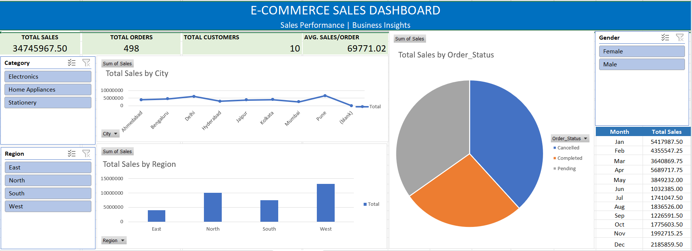

# ecommerce-sales-analytics-excel

An Excel-based project for analyzing e-commerce sales data and presenting business insights through an interactive dashboard.

## 📊 Dashboard Preview

## 🎯 Project Objectives

- Analyze sales performance by category, region, and city.
- Track key performance indicators (KPIs).
- Perform data quality checks and prepare sales data for analysis.
- Present findings using Excel charts and PivotTables.

## 🛠️ Tools and Features

- Microsoft Excel
- Excel formulas and functions
- Data cleaning and validation
- PivotTables and PivotCharts
- Interactive slicers
- Dashboard visualization

## 📌 Key Dashboard Metrics

- Total Sales
- Total Orders
- Total Customers
- Average Sales per Order

## 📁 Project Files

- **[Excel Workbook](Ecommerce_Sales_Analysis.xlsx)** — Main project workbook.
- **[Dashboard Screenshot](Dashboard.png)** — Dashboard preview.
- **[Project Guide](ProjectGuide.png)** — Workbook structure and documentation.

## 📚 What I Learned

- Organizing and checking sales data.
- Analyzing sales by different business dimensions.
- Building charts and KPI summaries in Excel.
- Presenting data in a dashboard for easier interpretation.

## 📝 Conclusion

This project demonstrates practical skills in Excel-based data cleaning, sales analysis, and dashboard reporting.

